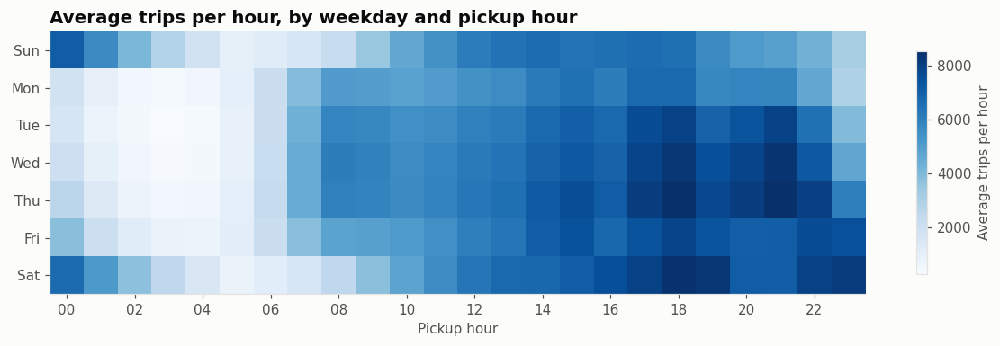
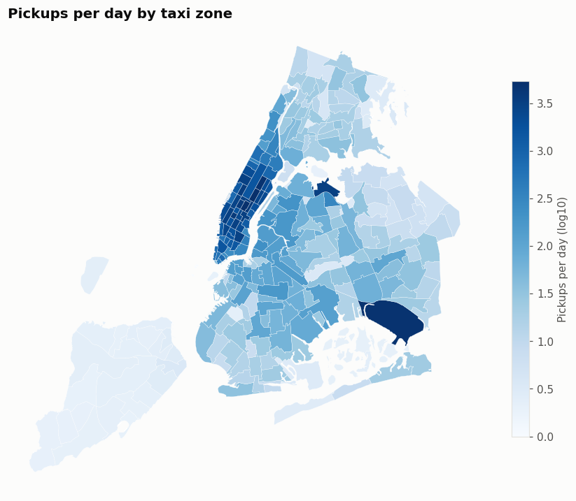
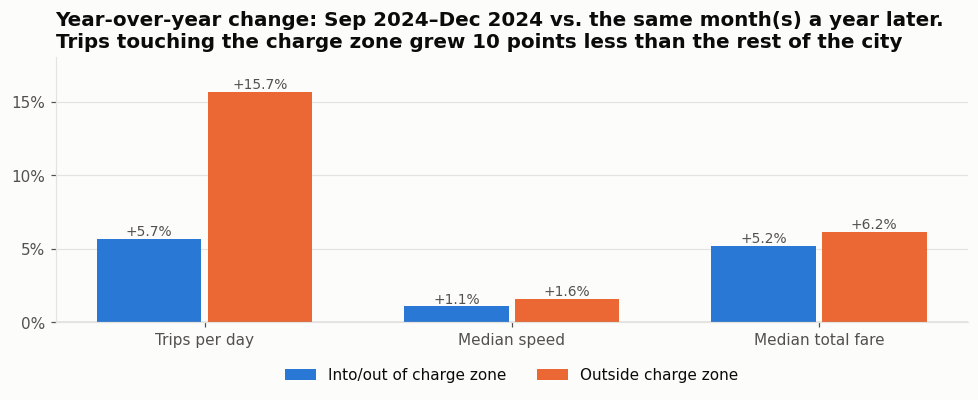
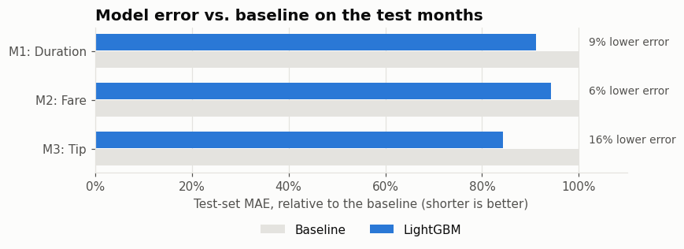
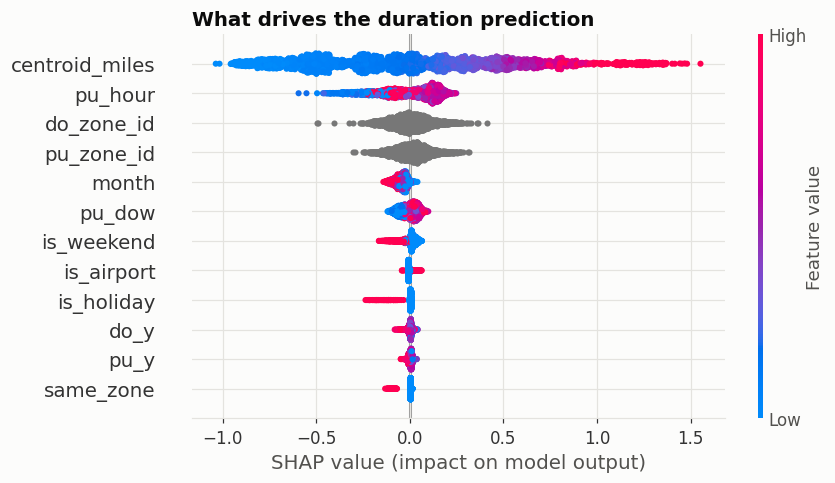
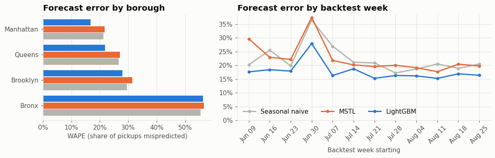

# NYC Yellow Cab: demand, pricing and forecasting

**Live dashboard: [xzhou-c-nyc-taxi-streamlit-app-7zgufr.streamlit.app](https://xzhou-c-nyc-taxi-streamlit-app-7zgufr.streamlit.app/)**

An end-to-end analysis of 24 months of NYC yellow cab trips (September 2024 to August 2026, 85,286,518 trips after cleaning). It covers a DuckDB pipeline, exploratory analysis, trip-level prediction models, an hourly demand forecast for 56 zone series, and a Streamlit dashboard that serves all of it.

**Core question:** how do when, where and how far people ride shape what a trip costs, how long it takes, and how many rides a zone will need next week?

## Key findings

- **Airports punch far above their weight.** JFK is 4.8% of trips but 13.5% of revenue; LaGuardia is 3.6% of trips and 8.7% of revenue.
- **Midday is the most expensive time to ride per mile.** The median fare per mile peaks at $8.27 at noon and bottoms out at $5.58 at 4 am, because the meter charges for time spent in slow traffic.
- **Manhattan crawls.** Median trip speed there falls to about 7.5 mph mid-afternoon, against about 28 mph for Queens trips after midnight.
- **Congestion pricing slowed growth in the charge zone.** Comparing September–December 2024 with the same months a year later, trips touching the charge zone grew 5.7% while trips outside it grew 15.7%, a gap of about 10 points.
- **Short trips get the biggest tips as a percentage.** The median card tip is about 32% of the fare on trips under a mile and about 22% on trips over 10 miles, consistent with flat-dollar tipping.

## Models

Every model uses only what is known when a ride is booked (pickup time, pickup zone, drop-off zone) and is scored on later months it never saw.

| Model | Target | Result on the test months |
|---|---|---|
| LightGBM | Trip duration | 9% lower MAE than the median duration for the same route and hour |
| LightGBM | Metered fare | 6% lower MAE than the median fare for the same route and hour |
| LightGBM | Tip % on card trips | 16% lower MAE than the average tip for the pickup hour |

**What drives duration:** straight-line distance between zone centers matters most, then pickup hour. SHAP analysis showed the distance effect is the same at every hour; time of day scales a trip by a roughly fixed percentage rather than adding a rush-hour penalty for long trips.

## Demand forecast

Hourly pickups for the next 7 days for the top 50 zones plus one "other zones" series per borough, scored with a 12-week rolling-origin backtest.

- **Global LightGBM cut the error of seasonal naive (same hour last week) by about a fifth.** Across all 56 series its WAPE was 17.7% against 22.1%, its MASE 0.73 against 0.90, and its MAE 14.1 against 17.6 pickups an hour. It won in all 12 backtest weeks.
- **The gain comes from the busy boroughs.** WAPE fell from 21.2% to 16.8% in Manhattan, 26.6% to 21.8% in Queens and 29.6% to 28.0% in Brooklyn.
- **The classical per-series model (MSTL) did not clear the naive bar** (MASE 0.89, WAPE 22.5%), which made the case for a single model trained across all zones.
- **Training only on data after congestion pricing began (January 2025) changed nothing** (MASE 0.733 vs. 0.735), so the older history neither helped nor hurt.
- **Holiday features carried the hardest week.** In the July 4 week, LightGBM's error rose to 28%, against 37% for the other two models.
- **Sparse series sit at a noise floor.** With only a few pickups an hour, every model's WAPE in the Bronx was about 55%, close to the limit for Poisson counts at that volume. On Newark Airport and Staten Island, where pickups are rare, no model beat seasonal naive, and LightGBM did worse on Newark.
- Features use only data at least 168 hours old, so the backtest reflects what a real 7-day-ahead forecast could know.

## Dashboard

| Page | Shows |
|---|---|
| Overview | Trips, revenue, average fare and tip % by month, with change against the month before |
| Map | Average pickups per hour by zone, filtered by weekday and hour, with each zone's weekly trend |
| Trip estimator | Predicted duration, fare and tip for any origin, destination and time, plus the best time to leave |
| Forecast | Next week's hourly pickups per zone, with backtest accuracy |

The app reads a small DuckDB file of precomputed aggregates and gzipped models, so pages load quickly and it never touches raw trips.

## How it's built

| Step | Notebook | What it does |
|---|---|---|
| 1. Pipeline | [`notebooks/P1_data_prep.ipynb`](notebooks/P1_data_prep.ipynb) | Downloads monthly TLC Parquet files, standardizes schema drift, flags bad rows by rule, enriches with zones, holidays and airport and congestion-zone flags, builds zone-hour and daily aggregates |
| 2. EDA | [`notebooks/P2_eda.ipynb`](notebooks/P2_eda.ipynb) | One DuckDB query and chart per question: when, where, airports, fares, tips, speed, congestion pricing |
| 3. Models | [`notebooks/P3_models.ipynb`](notebooks/P3_models.ipynb) | Duration, fare and tip models with time-based splits, fallback baselines, error breakdowns and SHAP |
| 4. Forecast | [`notebooks/P4_forecast.ipynb`](notebooks/P4_forecast.ipynb) | Seasonal naive, MSTL and global LightGBM, rolling-origin backtest, next-week forecast |
| 5. Dashboard | [`notebooks/P5_dashboard.ipynb`](notebooks/P5_dashboard.ipynb) | Exports aggregates and models, writes the Streamlit app |

**Stack:** Python, DuckDB, pandas, LightGBM, statsforecast, SHAP, GeoPandas, Matplotlib, Plotly, Streamlit. Notebooks run in Google Colab with data on Google Drive.

**Data:** [NYC TLC Trip Record Data](https://www.nyc.gov/site/tlc/about/tlc-trip-record-data.page), yellow taxi trips, September 2024 to August 2026, plus the TLC taxi zone lookup and shapefile.

## Run it yourself

1. Open each notebook in `notebooks/` in Colab in order and run it top to bottom. Phase 1 downloads about 2 GB of data to your Google Drive.
2. Phase 5 writes the app to `dashboard/` on Drive and downloads it as a zip.
3. Locally: `pip install -r requirements.txt`, then `streamlit run streamlit_app.py`.
